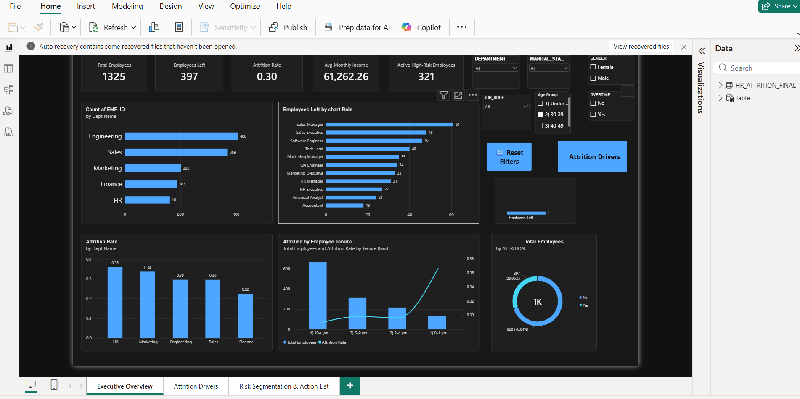
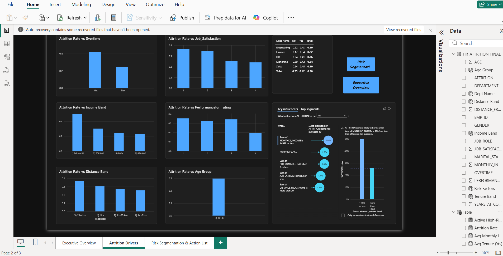
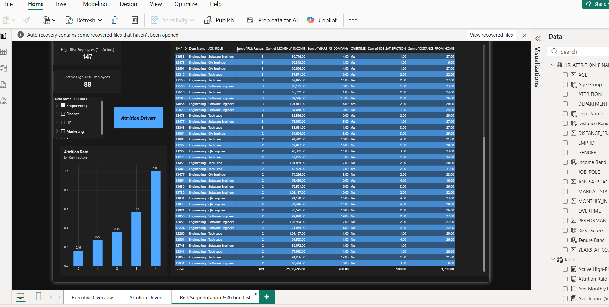

# 📊 HR Attrition Analytics Dashboard

An interactive HR Analytics dashboard built using Power BI to analyze employee attrition patterns, identify key drivers of employee turnover, and segment high-risk employees.

## 🎯 Project Objective

The objective of this project is to help HR teams understand:

- Overall employee attrition
- Department and job-role-wise attrition
- Impact of overtime on attrition
- Income and tenure-related attrition patterns
- Impact of job satisfaction and performance
- Distance-from-home impact
- Employees with multiple attrition risk factors

## 🛠️ Tools & Technologies

- Power BI
- DAX
- SQL
- Snowflake
- Data Visualization

## 📌 Dashboard Pages

### 1. Executive Overview

Provides a high-level view of:

- Total Employees
- Employees Left
- Attrition Rate
- Average Monthly Income
- Active High-Risk Employees
- Department-wise attrition
- Job-role-wise employee exits
- Tenure analysis

### 2. Attrition Drivers

Analyzes the major factors associated with employee attrition:

- Overtime
- Monthly Income
- Distance From Home
- Job Satisfaction
- Performance Rating
- Age
- Department
- Tenure

The page also includes Key Influencers analysis to identify important factors associated with employee attrition.

### 3. Risk Segmentation & Action List

Identifies active employees with multiple risk factors.

Risk factors include:

- Overtime
- Low Income
- Long Distance From Home
- Short Tenure
- Low Job Satisfaction

Employees with 2 or more risk factors are classified as high-risk employees.

## 📊 Key KPIs

| KPI | Value |
|---|---:|
| Total Employees | 4,700 |
| Employees Left | 1,359 |
| Attrition Rate | 28.9% |
| Average Monthly Income | ₹61,279 |
| Active High-Risk Employees | 1,118 |

## 🔍 Key Insights

- Overtime is associated with higher employee attrition.
- Employees with lower income show higher attrition.
- Employees with shorter tenure have higher attrition.
- Longer distance from home is associated with increased attrition.
- Lower job satisfaction is associated with higher employee turnover.
- Employees with multiple risk factors represent a higher-risk segment.

## 📈 DAX & Data Modeling

The dashboard uses DAX measures and calculated columns for:

- Attrition Rate
- Employees Left
- Employees Retained
- Average Monthly Income
- Average Tenure
- Average Job Satisfaction
- Overtime Percentage
- Risk Factor Scoring
- High-Risk Employee Identification

## 🎨 Dashboard Features

- Interactive slicers
- Cross-page slicer synchronization
- KPI cards
- Interactive charts
- Decomposition Tree
- Key Influencers
- Drill-through analysis
- Conditional formatting
- Risk segmentation

## 📷 Dashboard Preview

Screenshots of the dashboard are available in the `screenshots` folder.

## 💡 Business Value

This dashboard can help HR teams identify attrition patterns and high-risk employee segments, allowing them to focus retention strategies on areas with higher employee turnover risk.

## 🚀 Future Improvements

- Historical attrition trend analysis
- Automated data refresh
- Predictive attrition model
- Employee-level risk prediction
- Real-time HR analytics

## 👤 Author

Puja Devare
live Project Link: 🔗 GitHub: https://github.com/Pujadevare445/HR_Attrition_Analytics_Dashboard

---

⭐ If you find this project useful, feel free to explore the dashboard and analysis.

## 📸 Dashboard Preview

### 1. Executive Overview

### 2. Attrition Drivers

### 3. Risk Segmentation & Action List

